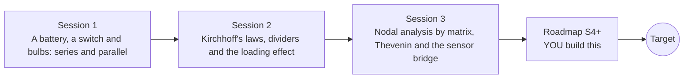

# opencircuitlab

[](https://github.com/KrunalPanchal1995/opencircuitlab/actions/workflows/ci.yml)   [](https://colab.research.google.com/github/KrunalPanchal1995/opencircuitlab/blob/main/sessions/session-01/lesson.ipynb) [](https://krunalpanchal1995.github.io/opencircuitlab/)

**Build series and parallel circuits and solve them with Kirchhoff's laws.**

opencircuitlab teaches circuit analysis from a battery and two bulbs to a matrix solver that handles any resistor network, using only Python and a browser.

- **Start from a battery and a bulb.** Session 1 needs only Ohm's law; every symbol is explained from scratch.
- **See it move.** Every session ships a slider app that runs in the browser, with labelled graphs and a challenge.
- **Know you got it right.** Each session ends with a checkpoint that prints PASS or FAIL against hand calculations and conservation of energy.
- **Build the missing half.** The repo stops at Session 3 on purpose; the roadmap shows the path to the Target.

[Target](#the-target) · [Who is this for](#who-is-this-for) · [Quick start](#quick-start) · [Sessions](#sessions) · [Roadmap](#roadmap) · [Contribute](#contribute) · [Explainer PDF](docs/explainer.pdf)

> **This repo is incomplete on purpose.** Sessions 1 to 3 are here and fully working. The finished Target below is a preview of what the community can build next. We show you the path, not the code. Sessions 4 and up are yours.

## The Target

An animated bridge circuit: one resistor is swept from 500 to 1500 ohm while every node voltage and every branch current is recomputed and drawn on the schematic. Beside it the Thevenin equivalent of the bridge output is drawn as a load line, with the operating point sliding along it, and a graph shows the output crossing zero at the balance point. Your goal over the coming sessions: build the solver behind it, then read circuits from a text netlist and animate any component sweep.


*Target: sweeping one bridge resistor while node voltages, branch currents and the Thevenin load line update*


*Target, one frame: R3 = 1155 ohm, the bridge is out of balance*


*Target, R3 = 500 ohm: the output voltage is negative*


*Target, R3 = 1500 ohm: the output voltage is positive*

Try it live:

- [Math Visual Studio (open playground)](https://krunalpanchal1995.github.io/studio/)

How the Target was made is shown only as a path in [promo/roadmap.md](promo/roadmap.md).

## Who is this for
**secondary school to diploma / undergraduate (levels 3-5).** Topic area: Electricity, Magnetism and Electronics.

Prerequisites:

- Ohm's law, V = I R, and the idea of a battery and a resistor (school physics).
- Python 3.10 or newer; if `python --version` works, you are ready. PRIMER.md explains the rest.
- Session 3 uses a little matrix algebra (solving two or three equations together); it is explained when needed.

New to Python? Read [PRIMER.md](PRIMER.md) first (10 minutes).

## Quick start

No installation knowledge needed. You need [Git](https://git-scm.com/downloads) and [Python 3.10+](https://www.python.org/downloads/) (Windows: tick "Add Python to PATH"). On Mac and Linux type `python3` wherever this page says `python`.

```bash
git clone https://github.com/KrunalPanchal1995/opencircuitlab.git
cd opencircuitlab
python start.py 1
```

`start.py` creates a private environment, installs what is needed and runs Session 1 with its checkpoint. Next: `python start.py 2`, `python start.py 3`, or `python start.py test` to check everything. Only a checkpoint: `python start.py check 1`.

Four lines solve a whole circuit with one matrix equation (they work as they are): Save it as `try.py` and run it with `python start.py run try.py` (this uses the private environment, where NumPy is installed):

```python
import numpy as np
G = np.array([[1/1000 + 1/2000 + 1/1000]])   # one node: R1 = 1 kohm from 12 V, R2 = 2 kohm and a 1 kohm load to ground
i = np.array([12 / 1000])                      # current pushed into the node through R1
print(np.linalg.solve(G, i).round(3))          # -> [4.8]  the node voltage in volts
```

Every session also opens in your browser with sliders (no install): [live apps](https://krunalpanchal1995.github.io/opencircuitlab/). Or use the Colab badge above for the notebook.

## Sessions

| # | Session | Model level | Time | Live app |
|---|---|---|---|---|
| 1 | [A battery, a switch and bulbs: series and parallel](sessions/session-01/README.md) | Level 1: conceptual interactive model | 60 min | [open](https://krunalpanchal1995.github.io/opencircuitlab/session-01/) |
| 2 | [Kirchhoff's laws, dividers and the loading effect](sessions/session-02/README.md) | Level 2: mathematical engineering model | 80 min | [open](https://krunalpanchal1995.github.io/opencircuitlab/session-02/) |
| 3 | [Nodal analysis by matrix, Thevenin and the sensor bridge](sessions/session-03/README.md) | Level 3: simulation and validation | 90 min | [open](https://krunalpanchal1995.github.io/opencircuitlab/session-03/) |

Each session follows the same six steps: A real-world problem, B concept and theory, C visual explanation, D interactive simulation, E worked example and experiment, F assessment and design challenge. Each ends with `checkpoint.py`, which prints `PASS` or `FAIL` against reference numbers. Session 3 also contains the real-world mini-project: **Design a Pt1000 temperature-sensor bridge**.

## Architecture



| Folder or file | What is inside |
|---|---|
| `sessions/` | three sessions: README (A-F), `lesson.py`, notebook, live app, exercises, activity sheet, checkpoint |
| `promo/` | the Target: media, live links, and the roadmap (path only) |
| `docs/` | `explainer.tex` and the built `explainer.pdf` |
| `tests/` | runs every lesson and checkpoint headless |
| `start.py` | one command to set up and run anything |
| `QUALITY.md`, `RUBRIC.md` | the quality checklist and the scoring rubric |
| `.github/` | CI, PDF build, Pages deploy, issue and PR templates |

## Roadmap

| Milestone | What you will build | Difficulty |
|---|---|---|
| Session 4: Read a netlist | A function that reads lines such as 'R1 1 2 1k' and 'V1 1 0 12' and returns the input of the solver. | beginner |
| Session 5: A nonlinear part: the diode | A diode stamp linearised at each iteration, solved inside a loop around the nodal solver. | intermediate |
| Session 6: An amplifier from a controlled source | A controlled-source stamp and an inverting amplifier built with it. | intermediate |
| Session 7: Sensitivity without Monte Carlo | A function returning dVout/dR for every resistor of any network. | advanced |
| Session 8: Time enters: the RC circuit | A transient solver for a resistor and a capacitor on a step input. | advanced |

Full detail with a checkpoint per milestone: [promo/roadmap.md](promo/roadmap.md).

## Contribute
New to GitHub? Read [CONTRIBUTING.md](CONTRIBUTING.md); it starts from zero. Pick an issue labelled `good first issue`. Translations into Hindi, Telugu, Tamil and Malayalam are welcome.

<details>
<summary>Development</summary>

```bash
python start.py test        # runs every lesson and checkpoint
```
Lessons use `# %%` cell markers so they open as notebooks in VS Code. See [QUALITY.md](QUALITY.md) for the standard every session meets.
</details>

## License
MIT. See [LICENSE](LICENSE). Media in `promo/media` is (c) Krunal Panchal, CC BY 4.0.

## Acknowledgments
Part of the [PAN IIT OSS](https://hellofoss.tech-iitb.org/projects) open-source teaching collection, modelled on the structure of [openspline](https://github.com/openspline/openspline). Built on ideas from the Math Visual Studio at https://krunalpanchal1995.github.io/studio/.
