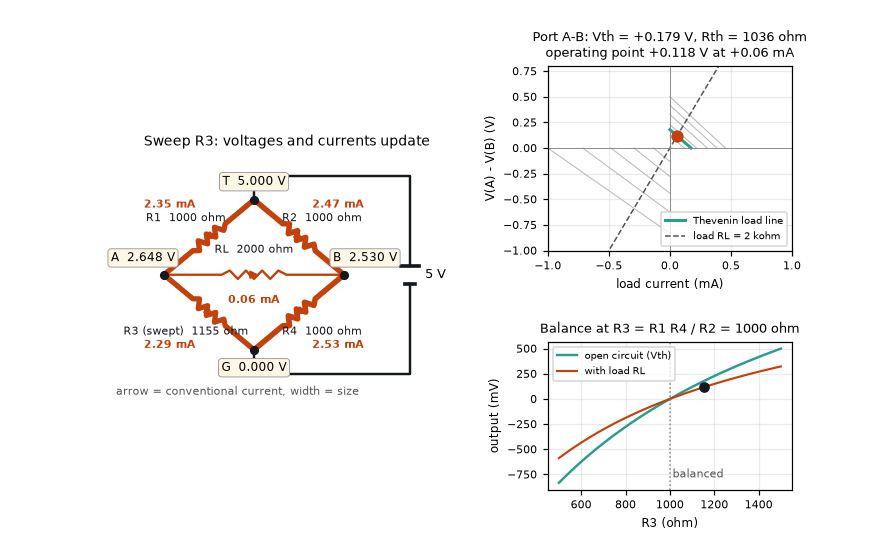
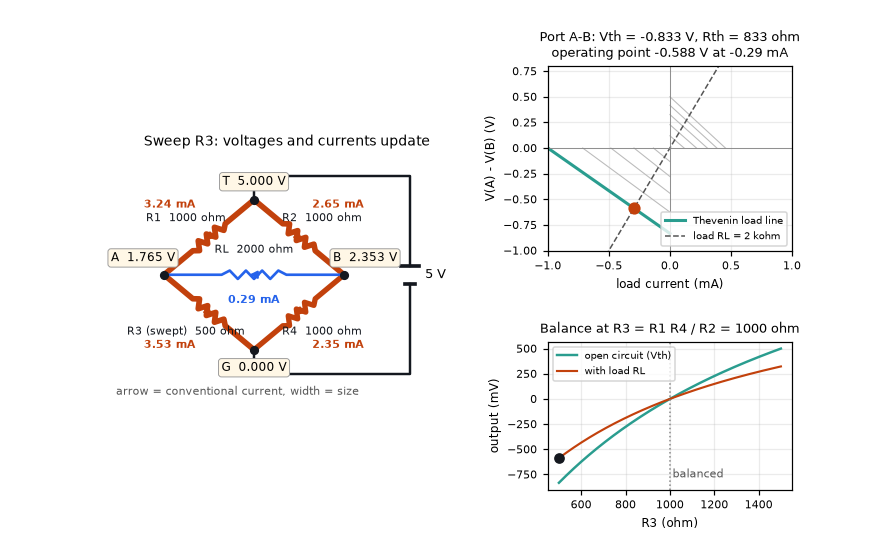
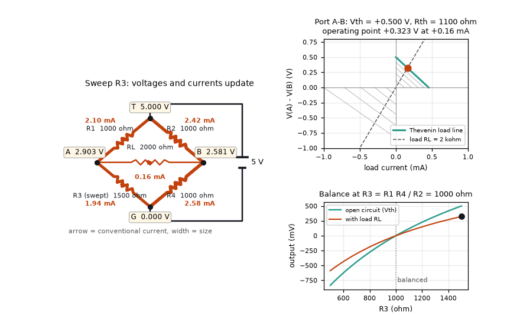

# What you are building toward

An animated bridge circuit: one resistor is swept from 500 to 1500 ohm while every node voltage and every branch current is recomputed and drawn on the schematic. Beside it the Thevenin equivalent of the bridge output is drawn as a load line, with the operating point sliding along it, and a graph shows the output crossing zero at the balance point. Your goal over the coming sessions: build the solver behind it, then read circuits from a text netlist and animate any component sweep.

*Target: sweeping one bridge resistor while node voltages, branch currents and the Thevenin load line update*

*Target, one frame: R3 = 1155 ohm, the bridge is out of balance*

*Target, R3 = 500 ohm: the output voltage is negative*

*Target, R3 = 1500 ohm: the output voltage is positive*

These results come from a private reference build. The code is not published; the roadmap shows the path so you can build your own.

Live links:

- [Math Visual Studio (open playground)](https://krunalpanchal1995.github.io/studio/)
