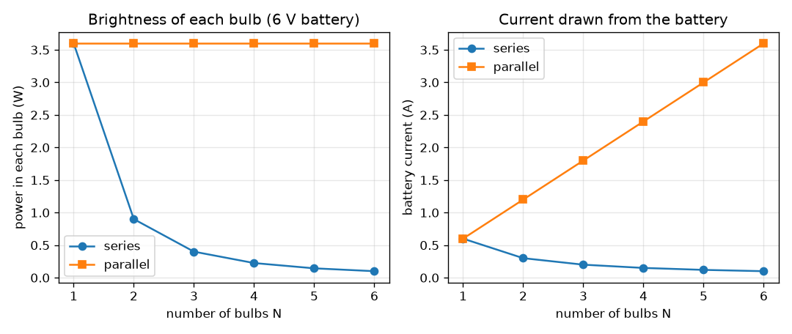
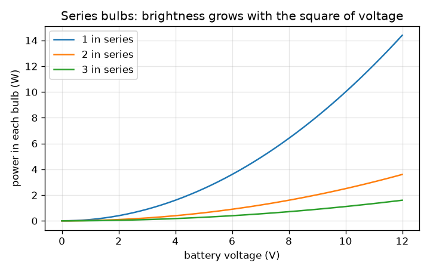

# Session 1: A battery, a switch and bulbs: series and parallel

*Level 1 (conceptual interactive model) · about 60 minutes · opencircuitlab*

> This is a simplified educational model. It is not a validated design tool and must not be used for real structures, electrical installations, vehicles, industrial processes or medical decisions.

**Prerequisites**

- Ohm's law, V = I R, from school physics.
- You have read PRIMER.md and run `python start.py 1` once.

**Learning objectives.** After this session you can:

- Explain why the current is the same everywhere in a series chain while the voltage is shared.
- Explain why bulbs in parallel each get the full battery voltage while the currents add.
- Calculate current, voltage and power for N identical bulbs in both wirings, by hand and in Python.
- Relate the brightness of a bulb to the power in it.

## A. Real-world problem
Old festival lights were wired in one long chain: when one bulb burned out, the whole string went dark, and when you added more bulbs, all of them got dimmer. A torch with two bulbs on the same battery behaves differently. Why does the same battery make bulbs glow dim in one wiring and bright in another, and what does the battery pay for the brightness? (Low-voltage educational circuits only: never experiment with mains electricity.)

## B. Concept and theory
A battery pushes charge round a closed loop. In a series chain there is only one path, so the same current passes through every bulb, one after another; the resistances add up and the battery voltage is shared between the bulbs. In a parallel bank every bulb is connected straight across the battery, so each gets the full voltage and carries its own current; the battery has to supply all those currents together. Power in a bulb is P = V I = I^2 R = V^2 / R, and we take brightness to be proportional to it. A switch is just a gap: open means no loop and no current.

| Symbol | Meaning | Unit |
|---|---|---|
| V | battery voltage | V |
| R | resistance of one bulb (model value 10) | ohm |
| N | number of identical bulbs | no unit |
| I | current drawn from the battery | A |
| P | power in one bulb (heat and light) | W |

**Assumptions**

- The battery is ideal: its voltage does not drop when current flows.
- A bulb is a fixed 10 ohm resistor. A real filament gets very hot and its resistance rises several times, so real brightness differs from this model.
- Wires have no resistance.

$$ I=\frac{V}{R}\qquad P=VI=I^2R=\frac{V^2}{R} $$

$$ \text{series: } R_{\mathrm{tot}}=NR,\quad I=\frac{V}{NR},\quad V_{\mathrm{bulb}}=\frac{V}{N},\quad P_{\mathrm{bulb}}=\frac{V^2}{N^2R} $$

$$ \text{parallel: } R_{\mathrm{tot}}=\frac{R}{N},\quad I=\frac{NV}{R},\quad V_{\mathrm{bulb}}=V,\quad P_{\mathrm{bulb}}=\frac{V^2}{R} $$

## C. Visual explanation
The first figure compares the two wirings for 1 to 6 bulbs on a 6 V battery. On the left, the power in each bulb stays at 3.6 W in parallel but falls as 1/N^2 in series (0.9 W for two bulbs, 0.4 W for three). On the right, the battery current falls in series (0.6 A for one bulb, 0.15 A for four) and grows in parallel (2.4 A for four): brightness in parallel is paid for by the battery. The second figure shows that for a series chain the brightness grows with the square of the battery voltage.

*Each bulb's power and the battery current for 1 to 6 bulbs on 6 V, in series and in parallel.*

*Series bulbs: the power in each bulb grows with the square of the battery voltage.*

## D. Interactive simulation
Run the lesson (`python start.py 1`), then open the live app: [Session 1: bulbs in series and in parallel](https://krunalpanchal1995.github.io/opencircuitlab/session-01/) (or `app.html` in this folder). Choose the number of bulbs and the wiring, then drag the battery voltage. Watch the voltage label under each bulb, the glow, and the battery current. Open the graph view and see the two curves of brightness against N.

**Challenge.** Wire three bulbs in series so that each one gets at least 1 W.

## E. Worked example and experiment
**Problem.** A 6 V battery feeds three bulbs of 10 ohm each. Find the current, the voltage across each bulb and its power for (a) the series wiring and (b) the parallel wiring.

1. Series: R_total = 3 * 10 = 30 ohm, so I = 6 / 30 = 0.2 A, the same in every bulb.
2. Voltage across each bulb = I R = 0.2 * 10 = 2 V (three of them add to 6 V, as they must).
3. Power in each bulb = V I = 2 * 0.2 = 0.4 W; total 1.2 W, which equals battery voltage times current, 6 * 0.2.
4. Parallel: each bulb sees 6 V, so its current is 6 / 10 = 0.6 A and its power is 6 * 0.6 = 3.6 W.
5. The battery supplies 3 * 0.6 = 1.8 A and 10.8 W in total. Parallel gives each bulb 9 times the power of series, since the voltage is 3 times larger and power goes with the square.

**Answer.** Series: 0.2 A, 2 V and 0.4 W per bulb. Parallel: 1.8 A from the battery, 6 V and 3.6 W per bulb.

**Experiment.** With a 4.5 V battery pack and two identical small torch bulbs, wire them first in series and then in parallel and compare their brightness by eye; unscrew one bulb in each arrangement and see what the other does. Measure the battery current with a multimeter if you have one. Expect the qualitative result of the model (dim and shared in series, bright in parallel, and one bulb failing kills the series chain only). The numbers will differ: a cold filament has a much lower resistance than a hot one, so the real current is larger than the model's the moment you switch on.

## F. Assessment and design challenge
**Question type A: Conceptual.** In a series string of festival bulbs, one bulb fails by breaking its filament. Why do all the other bulbs go out, and why would they stay lit in a parallel string?

Hint

A current needs a closed loop. How many loops are there in each wiring?

Step-by-step solution

In a series string there is only one path for the current. A broken filament is a gap in that path, so the current is zero everywhere and every bulb goes dark. In a parallel string each bulb has its own path straight across the battery. A gap in one path does not affect the others, so they keep their full voltage and stay lit (the battery just supplies a little less current).

**Question type B: Numerical.** A 9 V battery feeds three 10 ohm bulbs. Find the current and the power in each bulb for the series wiring and for the parallel wiring.

Hint

Series: R_total = N R. Parallel: each bulb has the full 9 V. Then P = V I.

Step-by-step solution

Series: R_total = 30 ohm, I = 9 / 30 = 0.3 A, each bulb gets 3 V and P = 3 * 0.3 = 0.9 W. Parallel: each bulb gets 9 V, I per bulb = 0.9 A, P = 9 * 0.9 = 8.1 W, battery current 2.7 A. Sanity check: parallel is 9 times brighter than series for 3 bulbs (N^2 = 9), and 0.9 * 9 = 8.1.

**Question type C: Graph and simulation interpretation.** On the brightness graph at 6 V, how many times dimmer is each bulb for 4 bulbs in series than for 4 bulbs in parallel? Read the two values from the curves.

Hint

Find the blue and green curves at N = 4.

Step-by-step solution

At N = 4 the green (parallel) curve is at 3.6 W and the blue (series) curve at 0.225 W. The ratio is 3.6 / 0.225 = 16 = N^2. The blue curve falls like 1 / N^2, the green one is flat.

**Question type D: Design and optimisation challenge.** Design: a small 6 V battery can supply at most 1 A. You must light three 10 ohm bulbs and want each to get at least 0.3 W. Compare three wirings: all series, all parallel, and one bulb in series with a parallel pair. Which are allowed, and which would you choose?

Hint

Compute the battery current and the power in each bulb for each wiring.

Step-by-step solution

All series: I = 0.2 A, 0.4 W per bulb: allowed. All parallel: I = 1.8 A, which is above the 1 A limit: not allowed. One bulb in series with a pair in parallel: R = 10 + 5 = 15 ohm, I = 0.4 A; the lone bulb gets 4 V and 1.6 W, each bulb of the pair 2 V and 0.4 W: allowed, and brighter overall, but unevenly. All series is the simplest and gives equal brightness; the mixed wiring gives more light at the cost of unequal bulbs and a failure of the lone bulb putting the whole circuit out. Assumption: ideal battery and fixed bulb resistance.

Score yourself with [RUBRIC.md](../../RUBRIC.md). Print the [activity sheet](activity_sheet.md) to work on paper.

## Common misconceptions
| Common misconception | What is actually true |
|---|---|
| The first bulb in a series chain uses up the current, so the last bulb is dimmer. | The current is the same everywhere in a series chain. The bulbs share the voltage, not the current. |
| A bigger battery voltage means a bigger current in parallel only. | The current rises with voltage in both wirings (I = V / R_total); what differs is R_total. |
| Bulbs in parallel are free brightness. | Each bulb draws its full current, so the battery current grows with every bulb, and the battery runs flat sooner. |
| More bulbs in series always means more light. | Total light power V^2 / (N R) actually falls with N; each bulb gets only 1/N of the voltage and 1/N^2 of the power. |

## Glossary
- **series**: components connected one after another in a single path
- **parallel**: components connected side by side, each straight across the same two points
- **current (I)**: the flow of charge, measured in amperes (A)
- **voltage (V)**: the push that drives the current, measured in volts (V)
- **resistance (R)**: how strongly a part opposes the current, in ohm
- **power (P)**: energy per second turned into heat and light, in watts (W)

## Finish
1. Do the three coding tasks in [exercises.md](exercises.md).
2. Run `python start.py 1` again after your changes. It ends with the checkpoint; when it prints `PASS`, you are done. (Checkpoint only: `python start.py check 1`.)

Next: [Session 2](../session-02/README.md)
