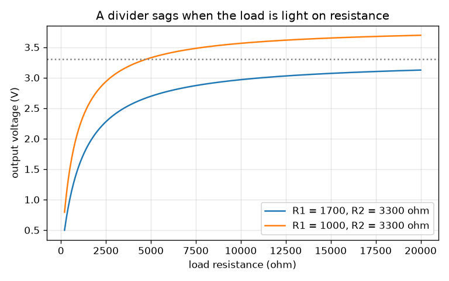
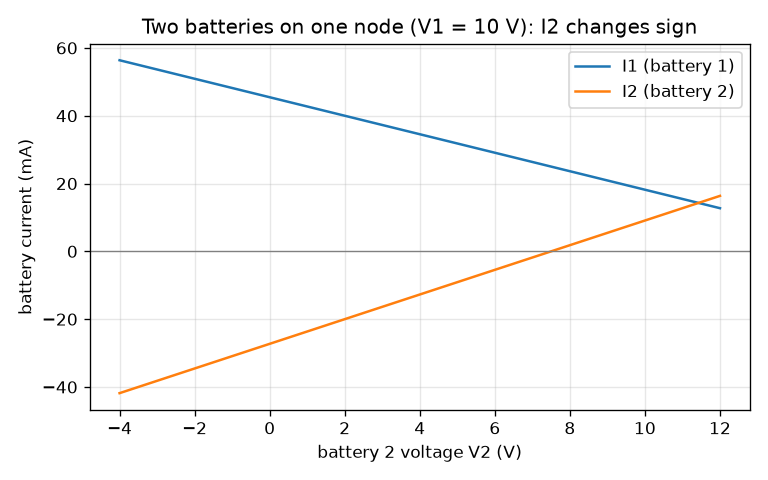

# Session 2: Kirchhoff's laws, dividers and the loading effect

*Level 2 (mathematical engineering model) · about 80 minutes · opencircuitlab*

> This is a simplified educational model. It is not a validated design tool and must not be used for real structures, electrical installations, vehicles, industrial processes or medical decisions.

**Prerequisites**

- Session 1: series, parallel, Ohm's law and power.
- Solving two equations with two unknowns by elimination (shown in Section E).

**Learning objectives.** After this session you can:

- State Kirchhoff's current law (KCL) at a node and voltage law (KVL) around a loop, and apply both.
- Use the voltage divider and current divider formulas, and say when they are valid.
- Predict how a load pulls down a divider's output (the loading effect).
- Solve a two-loop circuit by hand with simultaneous equations and check it with KCL, KVL and power.
- Design a divider that delivers a target voltage with a given load.

## A. Real-world problem
A microcontroller board runs on 3.3 V, but your battery pack gives 5 V. Two resistors can drop the voltage, and they do it perfectly until you connect the sensor: then the output sags to 2.7 V and the board misbehaves. And what if a second battery is connected to the same circuit, and the current in it flows the 'wrong' way? You need two laws that always hold, and a design method. (Low-voltage educational circuits only; this is a simplified model, not a design for real equipment.)

## B. Concept and theory
Kirchhoff's current law: at any node (a point where wires meet) the currents flowing in equal the currents flowing out, because charge does not pile up. Kirchhoff's voltage law: going once round any closed loop, the voltage rises and drops add up to zero, because energy is conserved. A voltage divider is two resistors in series across V_in: the same current I = V_in / (R1 + R2) flows through both, so V_out across R2 is V_in R2 / (R1 + R2). A current divider splits a total current between two parallel branches: the smaller resistor takes the larger share. A load R_L across R2 puts R_L in parallel with it, which lowers the lower resistance and so lowers V_out: this is the loading effect. For a circuit with two loops, write KVL for each loop with the loop currents as unknowns and solve the two equations together; a negative answer means the current really flows the other way. For a design, work backwards: the loaded lower resistance must equal R1 V_target / (V_in - V_target), and R2 is found from R2 || R_L.

| Symbol | Meaning | Unit |
|---|---|---|
| V_in | input voltage (5) | V |
| V_out | voltage across the lower resistor and the load | V |
| R1, R2 | upper and lower divider resistors | ohm |
| R_L | load resistance connected across R2 | ohm |
| I1, I2 | currents delivered by battery 1 and battery 2 | A |
| V_A | voltage of the node where both batteries and R3 meet | V |

**Assumptions**

- Ideal batteries (no internal resistance) and ideal resistors.
- The load is a plain resistor; a real sensor or chip may draw a current that depends on voltage.
- Direct current, steady state.

$$ \sum I_{\mathrm{in}}=\sum I_{\mathrm{out}}\ \text{(KCL)}\qquad \sum V_{\mathrm{loop}}=0\ \text{(KVL)} $$

$$ V_{\mathrm{out}}=V_{\mathrm{in}}\frac{R_2}{R_1+R_2}\qquad I_1=I_t\frac{R_2}{R_1+R_2} $$

$$ V_{\mathrm{out}}=V_{\mathrm{in}}\frac{R_2\parallel R_L}{R_1+R_2\parallel R_L},\qquad R_2\parallel R_L=\frac{R_2R_L}{R_2+R_L} $$

$$ \begin{pmatrix}R_1+R_3 & R_3\\ R_3 & R_2+R_3\end{pmatrix}\begin{pmatrix}I_1\\ I_2\end{pmatrix}=\begin{pmatrix}V_1\\ V_2\end{pmatrix} $$

$$ \frac{1}{R_2}=\frac{1}{R_{\mathrm{low}}}-\frac{1}{R_L},\qquad R_{\mathrm{low}}=\frac{R_1V_{\mathrm{target}}}{V_{\mathrm{in}}-V_{\mathrm{target}}} $$

## C. Visual explanation
The first figure plots the output of a 5 V divider against the load resistance. Both curves rise towards the unloaded value as the load gets lighter (larger R_L). The divider with R1 = 1700 and R2 = 3300 ohm gives exactly 3.3 V only with no load; with a 10 kohm load it gives 2.967 V and with 4.7 kohm 2.664 V. The second figure shows the two battery currents of the two-loop circuit as battery 2 changes: when V2 passes a critical value the current in battery 2 changes sign, which means battery 2 is being charged rather than supplying power.

*Output of a 5 V divider against the load resistance: a divider is only 'stiff' for light loads.*

*Currents of the two batteries as V2 changes (V1 = 10 V): I2 changes sign when battery 2 starts to be charged.*

## D. Interactive simulation
Run the lesson (`python start.py 2`), then open the live app: [Session 2: a loaded voltage divider](https://krunalpanchal1995.github.io/opencircuitlab/session-02/) (or `app.html` in this folder). Set the load to 20 kohm (almost no load) and read the output, then lower the load to 4.7 kohm and watch it sag. Change R1 and R2 and see the source current, the load current and the sag graph respond.

**Challenge.** With the 4.7 kohm load connected, get the output within 2 percent of 3.3 V while drawing no more than 6 mA from the source.

## E. Worked example and experiment
**Problem.** Battery 1 (V1 = 10 V) with R1 = 100 ohm and battery 2 (V2 = 4 V) with R2 = 200 ohm both feed node A; R3 = 300 ohm connects A to ground. Find I1, I2, the voltage V_A, and check with KCL, KVL and power.

1. Let I1 and I2 flow from the batteries towards A, so R3 carries I1 + I2. KVL on loop 1: 10 = 100 I1 + 300 (I1 + I2), that is 400 I1 + 300 I2 = 10.
2. KVL on loop 2: 4 = 200 I2 + 300 (I1 + I2), that is 300 I1 + 500 I2 = 4.
3. Determinant = 400 * 500 - 300 * 300 = 110000. I1 = (10 * 500 - 300 * 4) / 110000 = 3800 / 110000 = 0.034545 A. I2 = (400 * 4 - 300 * 10) / 110000 = -1400 / 110000 = -0.012727 A.
4. R3 carries I1 + I2 = 0.021818 A, so V_A = 300 * 0.021818 = 6.545 V. I2 is negative: battery 2 (4 V) is being charged by battery 1 because V_A is above 4 V.
5. Checks. KVL loop 2: 4 - 200 * (-0.012727) - 6.545 = 4 + 2.545 - 6.545 = 0. Power supplied: 10 * 0.034545 + 4 * (-0.012727) = 0.29455 W; dissipated: 0.11934 + 0.03240 + 0.14281 = 0.29455 W.

**Answer.** I1 = 34.55 mA, I2 = -12.73 mA (battery 2 is charged), V_A = 6.545 V; the power balance is 294.5 mW supplied and 294.5 mW dissipated.

**Experiment.** Build the 5 V divider of the design problem with a 1 kohm and a 2.2 kohm resistor from a 5 V USB supply or a battery pack, measure the output with a multimeter, then connect a 4.7 kohm resistor as a load and measure again; compare with the formulas. Differences of a few percent come from the 5 percent tolerance of ordinary resistors and from the meter's own input resistance (a cheap meter has 1 to 10 Mohm), which is itself a load: the model has ideal resistors and an ideal meter, the bench does not.

## F. Assessment and design challenge
**Question type A: Conceptual.** Why does connecting a load always lower the output of a voltage divider, and when can you safely ignore the load?

Hint

What happens to the resistance of the lower part when a load is put across it?

Step-by-step solution

The load is in parallel with R2, and a parallel combination is always smaller than either part: R2 || R_L < R2. A smaller lower resistance takes a smaller share of the input voltage, so V_out falls. The load can be ignored when R_L is much larger than R2 (a common rule is at least 10 times larger): then R2 || R_L is only slightly smaller than R2.

**Question type B: Numerical.** A 9 V source feeds R1 = 2 kohm in series with R2 = 1 kohm. Find the unloaded output, then the output with a 1 kohm load across R2. Check both with KVL.

Hint

With the load, the lower resistance is 1 kohm || 1 kohm.

Step-by-step solution

Unloaded: 9 * 1 / (2 + 1) = 3.0 V. With the load: the lower part is 0.5 kohm, so V_out = 9 * 0.5 / (2 + 0.5) = 1.8 V. KVL check: the current is 9 / 2.5 kohm = 3.6 mA, drop across R1 = 3.6 mA * 2 kohm = 7.2 V, and 7.2 + 1.8 = 9 V. The load took 40 percent of the output voltage away.

**Question type C: Graph and simulation interpretation.** In the loading graph for R1 = 1700 ohm and R2 = 3300 ohm, at roughly what load resistance does the output fall to 3.0 V (about 9 percent below the target)? Which direction does the curve move if R2 is made smaller?

Hint

The curve crosses 3.0 V between the readings at 10 kohm (2.967 V) and 47 kohm (3.223 V).

Step-by-step solution

The output is 3.0 V when the lower part is 2550 ohm, which needs R_L = 2550 * 3300 / (3300 - 2550) = 11.2 kohm: the curve crosses 3.0 V between 10 and 47 kohm, at about 11 kohm. Making R2 smaller lowers the whole curve (the unloaded value falls) but flattens it, since a smaller R2 is less disturbed by the same load. Reading the units: the x axis is ohm, the y axis volts.

**Question type D: Design and optimisation challenge.** Design: the output must be exactly 3.3 V from 5 V with a 4.7 kohm load. Compare R1 = 220 ohm, 470 ohm and 1000 ohm. For each, find R2, the source current and the error if the load is later unplugged. Which do you choose and why?

Hint

Use R_low = R1 * 3.3 / 1.7 and then 1 / R2 = 1 / R_low - 1 / R_L, or call design_r2 and stiffness_table in lesson.py.

Step-by-step solution

R1 = 220: R2 = 469.7 ohm, source current 7.73 mA, unplugging the load raises the output by 0.105 V. R1 = 470: R2 = 1132 ohm, 3.62 mA, +0.233 V. R1 = 1000: R2 = 3307 ohm, 1.70 mA, +0.539 V. Small resistors give a stiff divider (little change with the load) but waste current and heat; large resistors save current but change a lot if the load changes. A reasonable compromise is R1 = 470 or 1000 ohm depending on the battery budget; with a fixed load, R1 = 1000 and the standard 3.3 kohm (output 3.299 V, 1.7 mA) is within 0.1 percent. R1 = 4700 is impossible: the load alone would pull the output below the target.

Score yourself with [RUBRIC.md](../../RUBRIC.md). Print the [activity sheet](activity_sheet.md) to work on paper.

## Common misconceptions
| Common misconception | What is actually true |
|---|---|
| The voltage divider formula always gives the output voltage. | It holds only when nothing else draws current from the output; a load must be included in R2 \|\| R_L. |
| Current gets used up as it goes round a loop. | The same current leaves the battery and returns to it; what is used up is energy, shown as the voltage drops that add up to the battery voltage. |
| A negative current means the calculation is wrong. | It only means the real current flows opposite to the arrow you chose; here battery 2 is being charged. |
| The current divider gives more current to the larger resistor. | The smaller resistor takes the larger share: I1 = I_t R2 / (R1 + R2) is big when R2 is big, which is when R1 is the smaller one. |

## Glossary
- **node**: a point where two or more wires meet; all of it has one voltage
- **loop**: a closed path through the circuit that returns to its starting point
- **KCL**: Kirchhoff's current law: the currents into a node sum to zero
- **KVL**: Kirchhoff's voltage law: the voltages around a closed loop sum to zero
- **voltage divider**: two series resistors used to get a fraction of the input voltage
- **loading effect**: the drop of an output voltage when a load draws current from it
- **mesh current**: an assumed circulating current in one loop, used to write KVL

## Finish
1. Do the three coding tasks in [exercises.md](exercises.md).
2. Run `python start.py 2` again after your changes. It ends with the checkpoint; when it prints `PASS`, you are done. (Checkpoint only: `python start.py check 2`.)

Next: [Session 3](../session-03/README.md)
