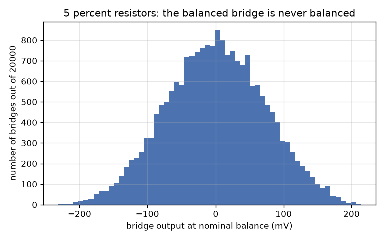
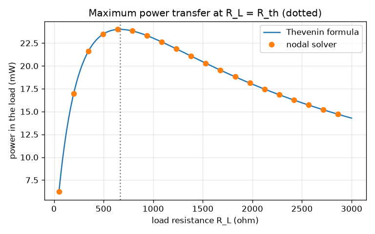
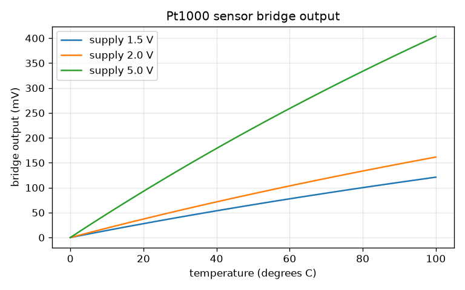

# Session 3: Nodal analysis by matrix, Thevenin and the sensor bridge

*Level 3 (simulation and validation) · about 90 minutes · opencircuitlab*

> This is a simplified educational model. It is not a validated design tool and must not be used for real structures, electrical installations, vehicles, industrial processes or medical decisions.

**Prerequisites**

- Session 2: KCL, KVL, dividers and the two-loop circuit.
- Solving a small linear system with numpy.linalg.solve (explained in Section B).

**Learning objectives.** After this session you can:

- Write KCL at every node as one matrix equation G v = i and build G with the stamp method.
- Validate a solver against hand-solved circuits and against conservation of energy (power supplied equals power dissipated).
- Find a Thevenin equivalent and verify numerically that maximum power transfer happens at R_load = R_th.
- Use the Wheatstone bridge balance condition and a Monte Carlo run to see how 5 percent resistors limit a sensor.
- Recognise the failure cases: a floating node, contradictory sources, and a short circuit.

## A. Real-world problem
A temperature sensor on a board is a resistor whose value changes by a fraction of a percent per degree. A Wheatstone bridge turns that tiny change into a measurable voltage, but every other resistor in the bridge is only guaranteed to 5 percent. Hand solving is already painful for three loops; real boards have hundreds of nodes. How do we let the computer solve any network, trust the answer, and predict how badly component tolerance spoils a measurement? (Low-voltage educational circuits only; this is a simplified model, not a design tool for real equipment.)

## B. Concept and theory
Number the nodes and choose one as the 0 V reference. A resistor R between nodes a and b carries g (v_a - v_b) with the conductance g = 1 / R. KCL at node a says the sum of these currents leaving the node equals the current injected into it: one row of the matrix equation G v = i. Each resistor adds a 'stamp' to G: +g on the two diagonal entries and -g on the two off-diagonal entries (rows and columns of the reference node are dropped). An ideal voltage source adds one unknown (its current) and one equation (v_p - v_m = V): this is modified nodal analysis. numpy.linalg.solve then finds all voltages in one call. Once solved, every branch current follows from (v_a - v_b)/R, and energy conservation (power supplied equals power dissipated) is a strong test of the answer. Seen from two terminals, any linear network equals a Thevenin source V_th in series with R_th (V_th: open-circuit voltage; R_th: the resistance with all sources switched off). A load R_L takes the power V_th^2 R_L / (R_th + R_L)^2, which peaks at R_L = R_th with value V_th^2 / (4 R_th); at that point the Thevenin source wastes as much as it delivers. A Wheatstone bridge is two dividers side by side; its output is zero (balanced) when R1 R4 = R2 R3, and near balance it is about V_s/4 times the fractional change of one arm. Component tolerances add up as random changes of all four arms, so a bridge built from 5 percent parts is never balanced exactly. If a node has no path to the reference, or two ideal sources disagree, the matrix is singular and there is no unique answer; a short circuit gives a perfectly valid but dangerous huge current.

| Symbol | Meaning | Unit |
|---|---|---|
| G | conductance matrix | S (siemens, 1/ohm) |
| v | vector of node voltages | V |
| i | vector of injected currents | A |
| g | conductance of one resistor, 1/R | S |
| V_th, R_th | Thevenin voltage and resistance | V and ohm |
| V_s | bridge supply voltage | V |
| tol | resistor tolerance (0.05 for 5 percent) | no unit |

**Assumptions**

- Linear resistors and ideal sources: no heating, no temperature effect, direct current only.
- Tolerance is modelled as a uniform random value within the stated band, independent for each resistor.
- The Pt1000 sensor uses a straight-line approximation of its resistance.

$$ G\,\mathbf v=\mathbf i,\qquad \text{stamp of } R_{ab}:\ G_{aa}\mathrel{+}=g,\ G_{bb}\mathrel{+}=g,\ G_{ab},G_{ba}\mathrel{-}=g,\quad g=\frac1R $$

$$ \sum P_{\mathrm{supplied}}=\sum_k \frac{(v_a-v_b)^2}{R_k}\quad\text{(power balance)} $$

$$ P_L=\frac{V_{\mathrm{th}}^2R_L}{(R_{\mathrm{th}}+R_L)^2},\qquad P_{\max}=\frac{V_{\mathrm{th}}^2}{4R_{\mathrm{th}}}\ \text{at}\ R_L=R_{\mathrm{th}} $$

$$ V_{\mathrm{out}}=V_s\left(\frac{R_3}{R_1+R_3}-\frac{R_4}{R_2+R_4}\right),\qquad \text{balanced when } R_1R_4=R_2R_3 $$

$$ \sigma_{V_{\mathrm{out}}}\approx\frac{V_s}{4}\cdot\frac{2\,\mathrm{tol}}{\sqrt3}\quad\text{(four equal resistors, uniform tolerance)} $$

## C. Visual explanation
The first figure checks maximum power transfer for the 12 V divider (V_th = 8 V, R_th = 666.7 ohm): the Thevenin formula (line) and the full nodal solver (dots) agree, and both peak at 24 mW exactly where R_L = R_th (dotted line). The second figure is the histogram of the output of 20000 'balanced' bridges built from 5 percent resistors on a 5 V supply: the spread is 72 mV (standard deviation), matching the small-change prediction, and only about 11 percent of bridges are within 10 mV of balance. The third figure shows the output of the Pt1000 bridge against temperature for three supply voltages: more supply voltage gives a bigger signal, but also more heat in the sensor.

*Output of 20000 nominally balanced bridges with 5 percent resistors on 5 V.*

*Load power against load resistance for the 12 V divider: Thevenin formula and nodal solver agree and peak at R_L = R_th.*

*Pt1000 bridge output against temperature for three supply voltages.*

## D. Interactive simulation
Run the lesson (`python start.py 3`), then open the live app: [Session 3: Thevenin equivalent and maximum power](https://krunalpanchal1995.github.io/opencircuitlab/session-03/) (or `app.html` in this folder). Open the circuit view and see that the source network and its Thevenin equivalent give the same load voltage and current. Then open the load-line view and slide RL along the line, and the power view to see the peak. Change R1, R2 and the supply and see V_th and R_th move.

**Challenge.** Match the load to the network: set RL equal to R_th (within 1 percent) so that the load receives the most power.

## E. Worked example and experiment
**Problem.** A 12 V source feeds R1 = 1 kohm in series with R2 = 2 kohm to ground. Find the Thevenin equivalent seen across R2, then the current, voltage and power in a 1 kohm load, and compare with the maximum power the network can ever deliver. Verify with one nodal equation.

1. V_th = open-circuit voltage across R2 = 12 * 2 / (1 + 2) = 8 V.
2. R_th: switch the source off (replace by a wire); R1 and R2 are then in parallel: 1000 * 2000 / 3000 = 666.7 ohm.
3. With a 1 kohm load: I = 8 / (666.7 + 1000) = 4.8 mA, V_load = 4.8 mA * 1 kohm = 4.8 V, P = 4.8 * 4.8 mA = 23.04 mW.
4. Maximum power: P_max = 8^2 / (4 * 666.7) = 24.0 mW, at R_L = 666.7 ohm. The 1 kohm load gets 96 percent of that.
5. Nodal check with the node between the resistors: (v - 12)/1000 + v/2000 + v/1000 = 0, so v * 0.0025 = 0.012 and v = 4.8 V. It agrees with V_load.

**Answer.** V_th = 8 V, R_th = 666.7 ohm; the 1 kohm load gets 4.8 V, 4.8 mA and 23.04 mW; the maximum possible is 24.0 mW at R_L = 666.7 ohm.

**Experiment.** Use a 12 V supply or, for safety, a 9 V battery pack, with the same ratio of resistors scaled to a few kilohm. Measure the open-circuit output (V_th), then connect different load resistors and measure the voltage across each; compute the power V^2 / R and see that it peaks near the load equal to R_th. Real batteries have an internal resistance that adds to R_th, and meters have a finite input resistance, so expect the peak a little lower and flatter than the model; the model has ideal sources and exact parts.

## Real-world application and mini-project: Design a Pt1000 temperature-sensor bridge
A Pt1000 sensor has the resistance 1000 (1 + 0.00385 T) ohm for a temperature T in degrees Celsius (a straight-line approximation). Put it in one arm of a Wheatstone bridge whose other three resistors are 1000 ohm, so the bridge is balanced at 0 degrees C. You choose only the supply voltage in steps of 0.1 V between 1.0 V and 5.0 V. Requirements: the output at 100 degrees C must be at least 100 mV, and the heat in the sensor at 100 degrees C must not exceed 1 mW (more heat warms the sensor and falsifies the reading). Use `sensor_bridge_out`, `sensor_power` and `monte_carlo_bridge` from Session 3.

**Deliverable:** A script that prints, for every supply voltage from 1.0 to 5.0 V, the output at 100 degrees C and the sensor heat, marks which voltages pass, picks the largest passing voltage, and then runs the Monte Carlo with 5 percent and with 1 percent resistors at that voltage, reporting the spread of the zero-point offset in mV and in equivalent degrees C. It also saves a graph of output against temperature.

**Success looks like:** The passing range is 1.3 V to 2.0 V; at 2.0 V the output at 100 degrees C is 161 mV and the sensor heat is 0.97 mW; the 5 percent resistors give a zero offset of about 29 mV (about 15 degrees C) and the 1 percent resistors about 5.8 mV (about 3 degrees C), and your write-up explains why the bridge needs a calibration (zeroing) step. The default 5 V supply fails the power limit (6.1 mW).

## F. Assessment and design challenge
**Question type A: Conceptual.** Why does a circuit with a node that is not connected to the reference node (a floating node) make G singular, and what does the error mean physically?

Hint

What fixes the voltage of a node? What happens to all voltages if you add 1 V to every node of the floating part?

Step-by-step solution

Only voltage differences matter to resistors. If a group of nodes has no path to the 0 V reference, adding the same voltage to all of them changes no current, so the equations cannot fix their absolute voltage: G has a zero eigenvalue, it is singular, and there are infinitely many solutions. Physically the floating part has no defined voltage: connect it to the reference (or add a reference resistor) to make it solvable. Two different ideal sources across the same two nodes are also singular: they demand two voltages at once.

**Question type B: Numerical.** For the 12 V, 1 kohm and 2 kohm network of Section E find the load that would receive 20 mW. Is there more than one answer? Check against P_max.

Hint

Solve V_th^2 R_L / (R_th + R_L)^2 = 0.020 with V_th = 8 V and R_th = 666.7 ohm; it is a quadratic in R_L.

Step-by-step solution

64 R_L = 0.020 (R_th + R_L)^2 gives R_L^2 + (2 R_th - 3200) R_L + R_th^2 = 0, that is R_L^2 - 1866.7 R_L + 444444 = 0. The roots are R_L = (1866.7 +- sqrt(1866.7^2 - 4 * 444444)) / 2 = (1866.7 +- 1306.4)/2 = 280.2 ohm and 1586.5 ohm. Two answers, one on each side of R_th = 666.7, since 20 mW is less than P_max = 24 mW. A target above 24 mW would have no solution.

**Question type C: Graph and simulation interpretation.** In the histogram of 20000 bridges with 5 percent resistors on 5 V, the standard deviation is 72 mV. A 1 percent change of one arm gives a signal of 12.4 mV. What does this tell you about using 5 percent resistors for a sensor, and what would change with 1 percent resistors?

Hint

Compare the spread with the signal. The spread scales with the tolerance.

Step-by-step solution

The offset error (72 mV, one standard deviation) is about six times larger than the signal from a 1 percent change in the sensor: the unadjusted bridge cannot resolve small changes, and only about 11 percent of bridges are within 10 mV of zero. With 1 percent resistors the spread shrinks 5 times to about 14 mV. In practice the zero offset is measured once and subtracted (calibration), or one arm is trimmed with a potentiometer.

**Question type D: Design and optimisation challenge.** Design: the Pt1000 bridge needs at least 100 mV at 100 degrees C and at most 1 mW in the sensor, with three fixed 1 kohm resistors. Choose the supply voltage, justify it, and say what limits the accuracy at 5 percent tolerance.

Hint

Use sensor_bridge_out(vs, 100) and sensor_power(vs, 100) for supply voltages in steps of 0.1 V, then run monte_carlo_bridge.

Step-by-step solution

The output is 80.7 mV per volt of supply, so 100 mV needs at least 1.3 V; the sensor heat grows as Vs squared (0.244 mW per V squared), so 1 mW allows at most 2.0 V. Any supply from 1.3 V to 2.0 V works; 2.0 V gives the largest signal (161 mV at 100 degrees C, 0.97 mW), while 1.5 V gives 121 mV and 0.55 mW with a safer margin on self-heating. The limit is the tolerance: at 2.0 V the 5 percent resistors give a zero offset of 29 mV (about 15 degrees C of equivalent error), 1 percent parts about 5.8 mV (about 3 degrees C). Trade-off: higher supply, more signal, more self-heating; tighter parts cost more. Assumption: linear Pt1000 model and no amplifier noise.

Score yourself with [RUBRIC.md](../../RUBRIC.md). Print the [activity sheet](activity_sheet.md) to work on paper.

## Common misconceptions
| Common misconception | What is actually true |
|---|---|
| Maximum power transfer means maximum efficiency. | At R_L = R_th the Thevenin source delivers half its power to the load and wastes half; efficiency is only 50 percent. Power stations never match their loads. |
| A singular matrix means my code has a bug. | Often it means the circuit is ill-posed: a floating node or contradictory sources. The error is information about the circuit. |
| A short circuit is a 'division by zero' and gives infinity. | A real battery has an internal resistance; the current is large but finite (8.9 A for a 9 V pack with 1 ohm internal resistance and a 0.01 ohm wire) and the heat in the battery is 79 W: dangerous, not infinite. |
| Matching the nominal values of a bridge makes it balanced. | With real tolerances the output has a random offset; the nominal balance only describes the average of many bridges. |

## Glossary
- **conductance**: 1/R, how easily a part lets current through, in siemens
- **stamp**: the fixed pattern a component adds to the matrix G
- **Thevenin equivalent**: one source and one resistor that behave like a whole network seen from two terminals
- **maximum power transfer**: the load R_L = R_th takes the most power from a given source
- **Wheatstone bridge**: two dividers whose outputs are compared; zero when R1 R4 = R2 R3
- **Monte Carlo**: repeating a calculation with many random inputs to see the spread of the result
- **singular matrix**: a matrix with no inverse; the equations have no unique solution

## Finish
1. Do the three coding tasks in [exercises.md](exercises.md).
2. Run `python start.py 3` again after your changes. It ends with the checkpoint; when it prints `PASS`, you are done. (Checkpoint only: `python start.py check 3`.)

Next: the [roadmap](../../promo/roadmap.md). Session 4 is yours to build.
